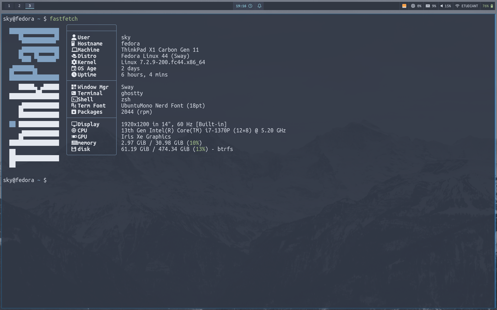

# SwayWM Dotfiles for my Thinkpad X1 gen 11 (. 📁)

- My SwayWM Nord Setup is finally completed, so here you go, it's all yours !

## Packages

- You will need alot of packages and dependencies to be installed to ensure everything works fine

```swaync (instead of dunst and mako), brightnessctl, udiskie, wlogout (for a better wayland powermenu), flameshot (for screenshots), ghostty (or whatever you like ), fastfetch, swaylock, swayidle, rofi, Nerd fonts, zsh (optional, you can use whatever you shell you like), waybar, Nerd Fonts (Mandatory)```

## Links

- Link for JetBrains Nerd Font : https://github.com/ryanoasis/nerd-fonts/releases/download/v3.5.1/JetBrainsMono.zip

- Link for Ubuntu Nerd Font : https://github.com/ryanoasis/nerd-fonts/releases/download/v3.5.1/UbuntuMono.zip


## Preview



## Setup

```bash
    git clone https://github.com/0x01sky/sway-dotfiles && cd sway-dotfiles
    # and then copy what you like to ~/.config
```

**Best Wishes!**


